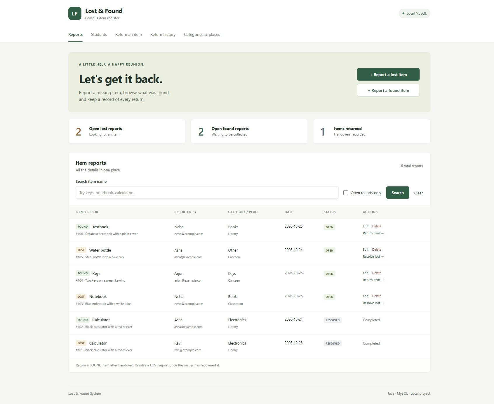
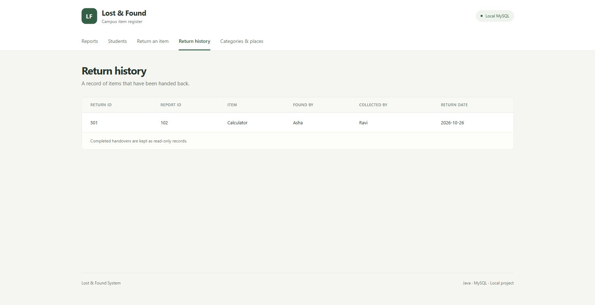

# Campus Lost and Found

[](https://github.com/pushpakmorey27/lost-and-found-java-mysql/actions/workflows/tests.yml)

A local campus lost-and-found application built with **Java, JDBC and MySQL**. Students can report an item, search existing reports and record a confirmed handover through a browser.

The project focuses on a small, understandable workflow and reliable database updates. It uses Java's built-in HTTP server, ordinary HTML forms and SQL stored procedures rather than a web framework.



## What it does

- Register students and their contact details.
- Create LOST and FOUND reports with a category, location, date and description.
- Search by item name and filter reports.
- Correct the description of an OPEN report or delete an incorrect OPEN report.
- Record who collected a found item and view return history.
- Resolve a lost report after the owner confirms recovery.

Matching is manual: two similar descriptions do not prove that they describe the same physical item.

## Run locally

**Requirements:** JDK 21 or newer, MySQL Community Server 8.4, and a browser. MySQL Workbench is optional. The JDBC driver is included in `lib/` with its licence information.

1. Download this repository using **Code → Download ZIP**, then extract it. Alternatively, clone it:
   ```sh
   git clone https://github.com/pushpakmorey27/lost-and-found-java-mysql.git
   cd lost-and-found-java-mysql
   ```
2. Start MySQL. On Windows, run **`1-Setup-Database.cmd` once** and enter your MySQL administrator password. The script creates `lost_and_found` with fictional sample records. It does not replace an existing database.
3. Create the application's `lf_user` account using the short SQL block in the [setup guide](docs/SETUP.md#3-create-a-database-account-for-the-application).
4. Run **`run-website.cmd`**. At the first login, press Enter for the default URL and username, then enter the password you chose for `lf_user`.
5. Open **http://127.0.0.1:8080/**. Keep the Java window open; press **Ctrl+C** there to stop it.

Linux and macOS users can import the same SQL file with the MySQL client and run `bash launch.sh`; see the [complete setup guide](docs/SETUP.md).

The login is remembered outside the repository. Subsequent launches need only a running MySQL service and the website launcher. The saved password is plain text: use a dedicated local account and keep that settings file private.

## A useful database example

A handover needs two related changes: insert a return record and mark its FOUND report RESOLVED. `lf_record_return` performs both inside one transaction. If either statement fails, the procedure rolls back the transaction and rethrows the error.

The schema also uses foreign keys, a unique return per found report, check constraints and triggers for report/return rules. Read the [design decisions](docs/DESIGN-DECISIONS.md) for the boundaries of these guarantees.



## Project structure

```text
src/
  start/       Main: starts the local website
  items/       Student, Item, LostItem, FoundItem and ReturnRecord
  database/    Database: JDBC operations; Actions: console contract
  website/     Website, WebPages and FormInput
  console/     Optional text menu and temporary practice data
database/      Schema, fictional seed data and inspection queries
web/           CSS stylesheet
tests/         Automated checks
docs/          Setup, architecture and interview preparation
lib/           MySQL Connector/J and third-party notices
```

There are 14 project classes and one project interface. `Item` is abstract; `LostItem` and `FoundItem` supply their own report type. The browser application uses MySQL. The optional console can use either MySQL or temporary arrays through `Actions`.

## Check the project

Run the checks that do not require MySQL:

```bat
test.cmd
```

On Linux/macOS:

```sh
bash test.sh
```

The optional integration checks need a MySQL account allowed to create and drop a test database. Set `LF_TEST_MYSQL_URL` to a server URL without a schema (for example `jdbc:mysql://127.0.0.1:3306/`), plus `LF_TEST_MYSQL_USER` and `LF_TEST_MYSQL_PASSWORD` in your terminal, then run:

```bat
test.cmd --mysql --reset-test-database
```

On Linux/macOS, use `bash test.sh --mysql --reset-test-database`. The explicit reset option allows the runner to rebuild its fixed `lost_and_found_test` schema. It does not use the application's `lost_and_found` database. See `tests/README.md` for the checks and environment setup.

## Design and scope

- [Architecture and ER diagram](docs/ARCHITECTURE.md)
- [Design decisions and limitations](docs/DESIGN-DECISIONS.md)
- [Setup and troubleshooting](docs/SETUP.md)
- [Interview explanation and code navigation](docs/INTERVIEW-NOTES.md)

This is a local demonstration application. It has no user accounts, role-based authorization, connection pool or automatic item matching. Requests share one database connection and are handled one at a time. It is not intended to be exposed as a public website.

## Author and licence

Created by **Pushpak Morey** as a college Java OOP and RDBMS project.

Project code is available under the [MIT licence](LICENSE). MySQL Connector/J keeps its own licence; see [third-party notices](THIRD_PARTY_NOTICES.md) for the included driver and corresponding source.
