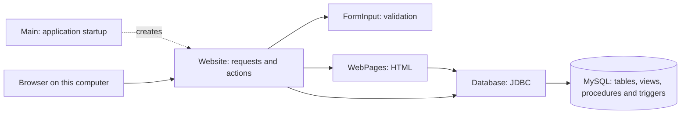
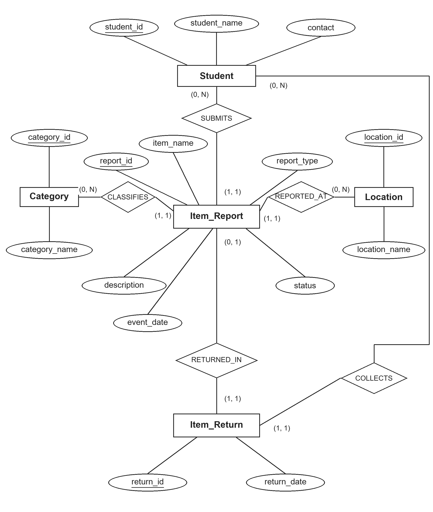

# How the application fits together

The browser displays HTML produced by Java. Java reads and changes MySQL through JDBC. MySQL stores the records and enforces database rules.



`Main` creates the server, database connection and `Website` object at startup. It is not a framework that automatically discovers classes; the objects are connected through ordinary constructor calls.

## Read the code in this order

| File | Responsibility |
| --- | --- |
| `src/items/Student.java` | Groups a student's ID, name and contact. |
| `src/items/Item.java` | Holds details common to LOST and FOUND reports. |
| `src/items/LostItem.java`, `FoundItem.java` | Override `getReportType()` with LOST or FOUND. |
| `src/start/Main.java` | Reads CSS, opens the connection and starts the HTTP server. |
| `src/website/Website.java` | Chooses the action for each GET or POST request. |
| `src/website/FormInput.java` | Decodes form fields and validates numbers, text and dates. |
| `src/website/WebPages.java` | Builds HTML and escapes values inserted into pages. |
| `src/database/Database.java` | Runs parameterized SQL, calls procedures and reads results. |

There are no Java package declarations. Source folders group files by their purpose; the launcher compiles them together. Keeping this arrangement makes the original college project easy to navigate, though packages would be a useful next step as it grows.

## Example: reporting a found item

1. The browser requests the report form with GET.
2. The user submits its fields with POST to `/reports/add`.
3. `Website` checks the form token and request size. `FormInput` checks the values.
4. `Website.addItem()` creates a `FoundItem`, held in an `Item` variable.
5. `Database.addReport(Item)` binds the values into a `PreparedStatement`. Calling `getReportType()` selects the child's FOUND implementation.
6. MySQL checks foreign keys and report rules. Java commits a successful insertion.
7. The server sends a 303 redirect to the report list. Refreshing that list does not submit the POST again.

For a validation or SQL error, the application attempts a rollback and returns a readable error page.

## Example: returning an item

`Website.returnItem()` → `Database.recordReturn()` → JDBC `CallableStatement` → MySQL `lf_record_return`.

The procedure starts its own transaction, inserts the return and changes the corresponding FOUND report's status. It commits when both statements succeed; its exception handler rolls back and rethrows on failure. Java does not group unrelated changes into this procedure call.

The corresponding LOST report is a separate record. The user resolves it separately after confirming the match. The schema does not store a link between a lost report and a found report.

## Database model



| Table | Purpose |
| --- | --- |
| `lf_student` | Reporter or collector details. |
| `lf_category` | Reusable item categories. |
| `lf_location` | Reusable campus locations. |
| `lf_item_report` | One LOST or FOUND report, with OPEN or RESOLVED status. |
| `lf_item_return` | A confirmed handover for a found report, including collector and date. |

A student can submit many reports. A category or location can be used by many reports. A report can have zero or one return; the return must refer to a FOUND report. A student can collect many items. Required foreign keys make each report and return refer to existing records.

The initial data has 4 students, 4 categories, 4 locations, 6 reports and 1 return. It is fictional.

### Other database objects

- `lf_report_details` joins reports with readable student, category and location details.
- `lf_return_details` joins returns with item, finder and collector names.
- `lf_record_return` performs a handover transaction.
- `lf_resolve_lost_report` updates an OPEN LOST report after confirmation.
- Six triggers check insertion/update/deletion rules. MySQL uses separate triggers for different events.

Normal views store SELECT definitions, not a second permanent copy of the result rows.

## Optional console

`ConsoleMain` selects an implementation of the `Actions` interface:

```text
Actions
  ├── Database      → persistent MySQL records
  └── PracticeData  → temporary array records
```

`ConsoleMenu` works with that interface reference. The website holds a concrete `Database` object; it does not support switching to practice mode. `ReturnRecord` objects are used by the practice version, while the website sends return values directly to the database procedure.

## Runtime boundaries

The server binds to `127.0.0.1`. `Website.handle()` is synchronized so requests do not interleave operations on the same JDBC connection. This favors clarity over throughput. There are no application accounts or roles; any local user who can open the application can use its actions. See [design decisions](DESIGN-DECISIONS.md) for the tradeoffs.
